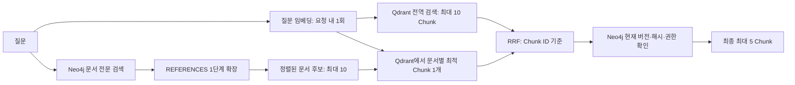

# 문서 중심 그래프·Qdrant 검색 설계

기준일: 2026-11-05. 현재 #27 작업 브랜치의 구현을 설명한다.

## 저장 구조

- Neo4j: Document 노드와 REFERENCES 엣지. 문서 제목·원문·메타데이터·분류·검토·버전·근거를 저장한다.
- Qdrant: 원문 Chunk와 임베딩. Neo4j와 document_id / version_id / content_hash로 연결한다.
- 원본 파일 위치는 입력 메타데이터로 받지만, 파일 다운로드·원본 파서와 장기 버전 보존은 아직 없다.
- 기존 Chunk 노드 전체 삭제는 하지 않는다. 문서 재적재 트랜잭션에서 해당 문서의 레거시 HAS_CHUNK 연결 노드만 제거한다.

Neo4j는 document_id와 현재 version_id에 유일 제약을 만들고, `document_text` 전문 인덱스를 `Document.title`, `Document.text`에 생성한다. 인덱스 준비를 기다린 뒤 적재한다. 공유 PostgreSQL DDL은 실행하지 않는다.

## Neo4j 문서 검색

질문에서 단어를 최대 12개 추출하고 Lucene 특수문자를 제거하여 OR 검색식을 만든다. 이 값은 Cypher에 직접 삽입하지 않고 파라미터로 전달한다.

시작 문서는 `status=유효`, `index_status=READY`, 접근 그룹 교집합 조건을 충족해야 한다. 전문 검색 점수 상위 10개를 시작점으로 선택한다. 각 문서 자체와 연결된 REFERENCES 문서를 양방향 1단계 탐색한다.

REFERENCES에는 source_version_id와 target_version_id가 있다. 엣지의 버전이 실제 양쪽 문서 노드의 현재 버전과 일치할 때만 확장한다. 이웃 문서도 유효·READY·권한 조건을 검사한다. 관련 문서 순위는 시작점 점수의 0.5배, 여러 경로에서 찾으면 최대 점수를 사용한다. 동점은 문서 ID로 정렬한다.

RELATED_TO의 의미 유사도 자동 생성·탐색은 아직 추가하지 않았다. 문서 관계는 검색 후보 확장을 위한 정보이며, 답변의 상세 근거는 Chunk 원문이다.

## Qdrant Chunk 검색

전역 검색은 질문 임베딩으로 코사인 유사도를 구하고 상위 10개를 반환한다. 문서 유효 상태·READY·허용 그룹을 필터링한다.

그래프 경로에서는 문서 후보의 document_id와 version_id를 함께 필터로 사용하고, 각 문서에서 유사도가 가장 높은 Chunk 하나를 가져온다. 문서 순서를 유지하며 최대 4개 조회를 동시에 실행한다. 접근 그룹·유효·READY 조건도 동일하게 적용한다.

이 두 경로는 의미적 역할이 다르지만 그래프 경로도 Qdrant에 의존한다. 따라서 Qdrant 장애 시 Neo4j 문서 결과만으로 상세 답변을 생성하지 않는다. pgvector 대안 코드가 남아 있어도 이 문서 중심 그래프 경로는 Qdrant를 요구한다.

## 융합과 최종 검증

RRF는 각 목록의 순위를 사용한다. 목록 안의 동일 Chunk는 한 번만 반영하고, 두 경로의 동일 Chunk ID를 합친다.

`RRF(chunk) = Σ 1 / (60 + rank)`

최대 20개를 융합한 뒤 Neo4j에서 다음 정보를 확인한다.

- document_id / version_id가 현재 문서와 일치.
- content_hash가 현재 문서 원문과 일치.
- 문서가 유효·READY이고 허용 그룹이 겹침.

검증에 통과한 순서에서 최대 5개를 선택한다. 최신 정보 확인이 실패하면 문서 원문을 반환하지 않고 AI_UNAVAILABLE로 처리한다. 전문 검색만 실패한 경우 벡터 결과를 사용할 수 있지만, 최종 현재 버전·권한 확인은 여전히 필요하다. 유사도 하한·별도 재정렬 모델·충분성 자동 평가는 아직 없다.

## 권한 및 운영 한계

현재 검색 서비스는 로컬 시험에서 ALLOWED_GROUP_IDS를 읽는다. 운영에서는 환경변수 그룹을 사용하지 않으므로 실제 사용자 AccessScope 계약이 연결되기 전에는 문서 근거를 반환하지 않는다. 적재 API의 allowedGroupIds는 신뢰할 수 있는 내부 호출자의 메타데이터다. 이를 사용자 로그인·실제 부서/직급/보안등급 검증이 완성된 것으로 간주하지 않는다.

새 검색 결과에 대한 검증과 달리, 기존 JEV의 캐시 재사용 경로는 현재 버전·권한을 재검증하지 않는다. 이 부분은 후속으로 연결해야 한다.

## 버전·재색인

Chunk ID는 문서·버전·본문 해시·청킹 설정·순번에서 만든 UUID5다. 같은 입력은 같은 ID를 만들고, 다른 문서·버전·본문·청킹 설정은 다른 ID를 만든다.

Neo4j에는 현재 문서 노드 하나를 유지한다. 낮은 버전 번호, 같은 번호의 다른 버전 ID, 동일 버전 ID의 다른 원문을 거부한다. Qdrant에는 먼저 STAGING으로 기록하고 두 저장소 공개 과정을 거친다. 정확한 순서와 부분 실패 한계는 [문서 적재 설계](문서_적재_설계.md)를 따른다.

## 확인 범위

Qdrant 필터·공개·문서별 회수·정리는 메모리 모드로 테스트한다. Neo4j는 드라이버 대역으로 파라미터·트랜잭션·문서 중심 쿼리 구조를 확인한다. 실제 Neo4j 서버에서 Cypher 실행·인덱스 준비·동시성·성능을 확인했다는 의미는 아니다.
