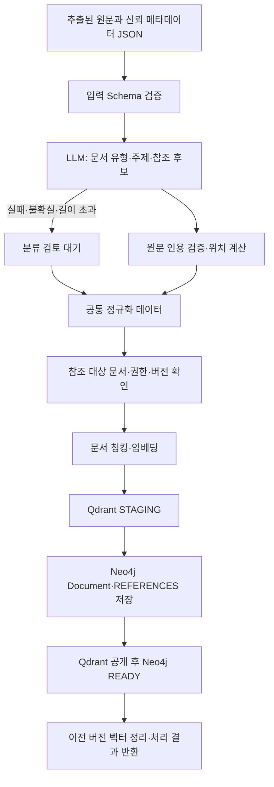

# 근거를 제시하는 사내 문서 검색 도우미

기준일: 2026-11-05

구현 기준: 이슈 #27, `feat/27-document-ingestion-schema`. 이 문서는 해당 작업 브랜치의 코드를 기준으로 작성한다. `dev` 배포 완료나 외부 서비스 연동 완료를 의미하지 않는다. 기존 AI 서버 `feat/agent-server`를 작업 브랜치에 merge한 상태이며, 통합 시 선행 PR #4 의존성을 확인해야 한다.

## 1. 목표와 문제

사내 문서에서 질문에 필요한 정보를 찾고, 답변을 뒷받침하는 원문과 위치를 제시한다. 여러 문서에 흩어진 정보와 참조 관계를 연결하고, 후속 질문에서는 확보한 근거를 재사용해 불필요한 검색을 줄인다.

문서의 의미를 세분화한 Entity·Claim·Change를 별도 노드로 만드는 초기안은 채택하지 않는다. 문서 하나를 Neo4j의 `Document` 노드 하나로 유지하고, 상세 원문은 Qdrant Chunk에서 회수한다.

## 2. 현재 구현과 후속 범위

| 항목 | 현재 작업 브랜치 상태 |
|---|---|
| 추출된 본문 JSON 입력 | AI 내부 API·CLI 구현 |
| 입력 속성·자료형 검증 | Pydantic Schema, 필수값·길이·허용 유형·권한 그룹 검증 |
| 원본 메타데이터 | 입력에서 매핑. 작성자·부서·날짜·권한을 LLM이 변경하지 못하도록 분리 |
| LLM 추출 | 문서 유형·주제/키워드·명시적 문서 참조 후보와 원문 인용 |
| 근거 검증 | 인용의 원문 포함 여부 확인, 실제 문자 위치 계산 |
| 미분류 | `documentType=null`, `classificationStatus=REVIEW_REQUIRED` |
| 관계 검증 | 대상 제목의 실제 문서 조회, 접근 범위·버전·중복·자기 참조 확인 |
| Neo4j | 문서 원문·메타데이터·검증 기록과 `REFERENCES` 저장 |
| Qdrant | Chunk·임베딩·출처·버전·권한·분류 속성 저장 |
| 신규 검색 | Qdrant 전역 의미 검색 + Neo4j 문서 검색 기반 Chunk 회수 후 RRF |
| JEV | 기존 서버의 컨텍스트 재사용 판정 흐름 유지 |
| 바이너리 원본 파서·OCR | 미구현. 파일 형식도 미정 |
| Notion·Drive 동기화 | 미구현 |
| Spring `/ingest` 파일 요청·콜백 | 이번 내부 텍스트 API와 별개. 계약 조정·연결 미구현 |
| 검토 대기 관리 화면·수동 승인 | 미구현. 현재는 사유와 후보를 데이터로 저장 |
| `RELATED_TO` 자동 생성·문서 충돌·변경 영향 알림 | 후속 기능 |
| 실제 사용자 AccessScope 연동·캐시 권한 재검증 | 후속 계약·구현 필요 |

## 3. 문서 적재 흐름

문서 파싱은 향후 AI 서버가 담당한다. 현재 구현의 시작점은 이미 추출된 `text`와 신뢰할 수 있는 메타데이터다. 입력 경로가 달라도 이후 동일한 규격을 사용한다. 문서 청킹은 적재 시 수행하며 사용자 질문마다 다시 하지 않는다.

LLM 분류가 실패해도 유효한 원문과 권한 정보가 있으면 저장을 진행한다. 저장소 장애·버전 충돌·필수 정보 오류는 분류 불확실성과 구분하여 적재 실패로 처리한다.

## 4. 추출·분류 기준

문서 유형은 `HANDOVER`, `APPROVAL`, `REPORT`, `PRESENTATION`, `ETC`를 사용한다. `ETC`는 기타로 분류된 경우이며, 판단 불가는 `null`이다. 원본 `documentType`이 있으면 LLM 결과보다 우선한다.

LLM 출력에는 문서 유형, 주제, 명시적 참조 후보와 각각의 인용만 허용한다. 권한·작성자·날짜 또는 임의의 대상 문서 ID를 반환하면 출력 Schema 검증에 실패한다. 원문에 없는 인용은 채택하지 않는다. 중복 주제·참조는 제거한다.

형식 및 인용 일치는 의미적 정답을 보장하지 않는다. 분류 정확성과 명시적 참조의 의미를 실제 문서 평가 세트로 검증해야 한다.

세부 필드와 실패 규칙은 [문서 적재 설계](문서_적재_설계.md), 기계 판독 규격은 [입력 Schema](schemas/document-submission.schema.json)와 [정규화 Schema](schemas/normalized-document.schema.json)를 따른다.

## 5. 저장·검색 구조

| 저장소 | 데이터 | 검색 역할 |
|---|---|---|
| Neo4j | 문서 노드, 문서 전체 텍스트, 분류·근거 기록, 문서 간 REFERENCES | 제목·본문 전문 검색과 참조 문서 1단계 확장 |
| Qdrant | 원문 Chunk와 임베딩, 문서·버전·권한·분류 메타데이터 | 전체 의미 검색, 그래프가 찾은 문서 안의 최적 근거 회수 |

새 적재는 Neo4j에 Chunk 노드를 생성하지 않는다. 기존 데모의 Chunk 노드는 해당 문서를 재적재할 때만 정리한다. 기존 DB를 일괄 삭제하거나 전체 재색인하지 않는다.

Neo4j 문서 순위를 그대로 Chunk 순위와 합치지 않는다. 후보 문서 각각에서 Qdrant의 가장 관련 있는 Chunk를 하나씩 회수하고 문서 순서를 유지한다. 이 목록과 전역 벡터 검색 목록을 Chunk ID로 RRF 융합한다.

현재 값은 검색 경로별 후보 10개, RRF `k=60`, 최종 근거 최대 5개다. 참조 확장 문서의 점수는 시작 문서 점수의 0.5배다. 문서별 Qdrant 조회 동시 실행 수는 최대 4다. 이는 구현 기본값이며 최적화 결과로 주장하지 않는다.

검색 후 Neo4j에서 현재 문서 버전·본문 해시·권한·유효 상태·READY 상태를 다시 확인한다. 확인에 실패하면 근거를 답변에 전달하지 않는다. 자세한 쿼리 흐름은 [검색·저장소 설계](검색_저장소_설계.md)에 정리한다.

## 6. 질문·답변과 컨텍스트

기존 서버는 컨텍스트가 없으면 검색하고, 컨텍스트가 있으면 JEV 재사용 확률을 구한다. 확률 0.7 이상이면 기존 컨텍스트, 그 미만이면 검색 경로를 선택한다. JEV가 없거나 실패하면 검색한다. 신규 검색은 두 경로를 실행하고 RRF 결과를 LLM에 전달한다. 근거가 없으면 관련 문서를 찾지 못했다고 응답한다.

현재 JEV 재사용 경로는 재사용 직전에 Neo4j 권한·버전을 재검증하지 않는다. 신규 검색에 추가한 검증을 캐시 재사용까지 적용했다고 해석하면 안 된다. 운영 사용자별 권한 범위를 받는 계약도 미정이어서 기존 서버는 운영 검색에 환경변수 그룹을 적용하지 않고 결과를 차단한다.

일반 대화를 별도 LLM 모드로 분기하거나 문서 충돌을 자동 판정하는 기능은 아직 없다. 컨텍스트는 메모리에 저장되며 보관 수·TTL을 설정한다. 서버 재시작 시 사라진다.

## 7. 버전·예외 처리

문서 식별자는 `documentId`, 버전 식별자는 `versionId`, 버전 순서는 `versionNumber`로 구분한다. 원문 SHA-256을 `contentHash`로 기록한다. 오래된 버전 번호, 같은 번호의 다른 버전 ID, 같은 버전 ID의 다른 본문은 Neo4j 트랜잭션에서 충돌 처리한다.

저장 공개는 STAGING → 벡터 공개 → 문서 READY 순서다. 분산 트랜잭션은 구현하지 않았다. 중간 실패 시 성공으로 응답하지 않고 재시도가 필요하다. 문서 노드가 새 버전 STAGING으로 갱신된 후 실패하면 이전 버전의 검색도 일시적으로 불가능할 수 있다. 최종 현재 버전 검증으로 잘못된 버전 노출을 막는다.

## 8. API·실행 및 백엔드 경계

AI 내부 텍스트 적재 API는 `POST /api/v1/ingestion/documents`다. 이는 백엔드에서 합의된 원본 파일 수집 API가 아니다. 원본 다운로드·파서·작업 ID·비동기 콜백은 추가 연결이 필요하다. 파일 위치만 전달하면 현재 적재 API는 원문을 읽을 수 없다.

기존 채팅 API는 `POST /api/v1/agent/chat`을 유지한다. 서버 간 합의된 계약은 `docs199-Server/docs/ai-server-contract.md`에서 관리하며, 이 브랜치가 해당 계약이나 공유 PostgreSQL Schema를 변경하지 않는다.

실행과 설정은 [로컬 실행 안내](local-setup.md), 기존 PostgreSQL 검토는 [PostgreSQL 연동 설계](postgresql_연동_설계.md)를 참고한다.

## 9. 평가와 차별화

Glean과 같은 서비스도 검색·그래프·인용을 제공하므로 기능 명칭만으로 독점적 차별성을 주장하지 않는다. 우리 시연은 원문 근거 확인, 문서 관계 탐색, 후속 질문에서 컨텍스트 재사용 및 검색 비용·지연 비교에 집중한다. 원문 근거 회수율, 분류 정확도, 관계 오검출, 미분류 비율, 재검색 판단 오류를 평가해야 한다.

해커톤 평가 배점은 제공 자료 기준 기술적 완성도 30, 혁신성·창의성 25, UX/UI 20, 발표·시연 15, 팀 구성·협업 10이다. 실험 전에는 비용 절감률이나 정확도 수치를 확정하지 않는다.

실제 수행한 검증과 한계는 [구현·검증 현황](구현_검증_현황.md)에 기록한다.

## 10. 남은 결정

- 지원 원본 파일·파서·OCR·페이지/bbox 표현과 시연 문서 종류·수량.
- 실제 문서로 분류·참조 추출 품질 측정 및 분류 근거의 적절성 평가.
- 긴 문서의 구간별 추출과 비용 한도. 현재는 LLM 입력 문자 한도 초과 시 검토 대기로 둔다.
- 백엔드 파일 접근·입력/콜백·AccessScope·문서 삭제/권한 변경 이벤트.
- 검토 결과의 승인·재처리·감사 이력 및 백엔드 표시.
- 캐시 컨텍스트의 현재 권한·버전 재검증과 영속 저장.
- 실패한 STAGING 데이터 정리, 분산 작업 재시도·중복 실행 정책, 버전 원문 보존.
- RELATED_TO 생성, 문서 상충 판단, 변경 영향 알림, 원문 뷰어·그래프 UI.

브랜치는 `main` → `dev` → 이슈 작업 브랜치로 운영한다. #27은 `dev`에서 분기한 뒤 사용자 선택에 따라 선행 AI 서버 브랜치를 merge했다. 통합 대상은 `dev`이며, 직접 main/dev에 push하지 않는다.
