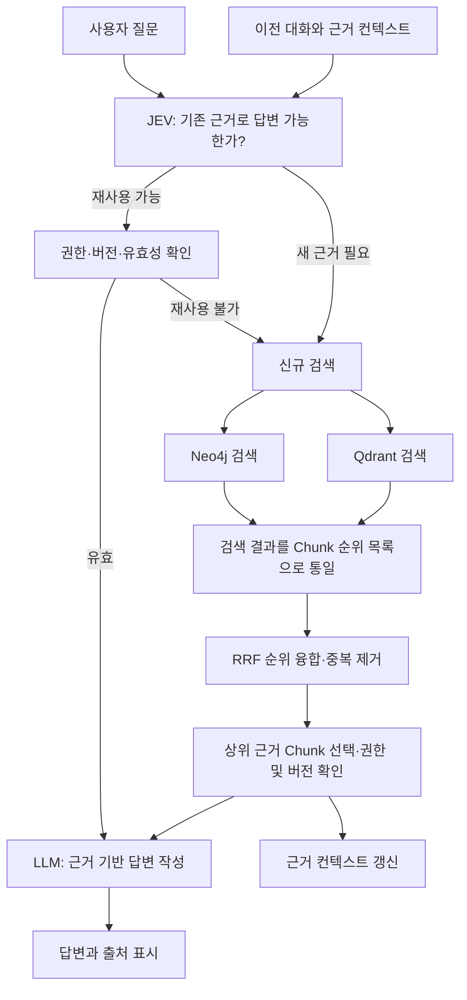
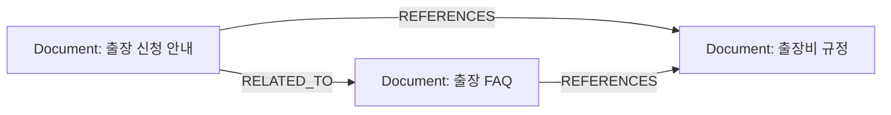

# 근거를 제시하는 사내 문서 검색 도우미

작성일: 2026-11-05

상태: 팀 논의를 반영한 기획 기준안. 세부 구현 정책은 별도 확정이 필요하다.

이 문서는 지금까지의 논의와 최신 AI 처리 구조 변경을 정리한다. 관련 이슈: [#1](https://github.com/9-jodae/docs199-AI/issues/1). 별도 로컬 데모와의 차이는 [로컬 데모 참고](로컬_데모_참고.md)에 기록한다. 이 레포에서 기능이 구현되었다는 의미는 아니다.

## 1. 프로젝트 개요와 문제 정의

사내 문서에서 질문에 필요한 정보를 찾아 답변하고, 사용자가 원문 근거와 문서 사이의 관계를 확인할 수 있도록 돕는 검색 서비스다.

기업 내부에 정보가 충분히 존재해도 여러 문서에 흩어져 있고, 문서 내용이 서로 충돌하거나 누락되어 필요한 정보를 정확하게 활용하기 어렵다. 사용자는 답을 찾은 뒤에도 출처, 문서의 유효성, 관련 문서를 추가로 확인해야 한다.

해결하려는 문제는 다음과 같다.

- 자연어 질문에 필요한 정보를 찾기 어렵다.
- 답변을 뒷받침하는 원문과 위치를 확인하기 어렵다.
- 문서 간 참조·연관 관계와 변경의 영향을 파악하기 어렵다.
- 이전 대화에서 확보한 근거를 다시 검색하는 비용이 발생한다.
- 권한이 없는 문서가 검색·답변·관련 문서 목록에 노출되지 않아야 한다.

한 줄 소개: **내가 볼 수 있는 사내 문서에서 답과 근거를 찾고, 후속 질문에는 유효한 기존 근거를 재사용하는 검색 도우미.**

## 2. 최신 합의 및 기존 기획에서의 변경

| 항목 | 최신 방향 |
|---|---|
| GraphDB | Neo4j 사용 |
| VectorDB | Qdrant 사용 예정 |
| 지식 그래프의 업무 노드 | 문서 하나당 `Document` 노드 하나 |
| 문서 내부 세부 내용 | 문서를 나눈 Chunk로 검색·인용 |
| 신규 검색 | Neo4j와 Qdrant 두 검색 결과를 모두 사용 |
| 검색 융합 | RRF로 순위 목록을 합친 뒤 상위 Chunk 선택 |
| JEV | 기존 컨텍스트로 답할 수 있는지, 신규 검색이 필요한지 판단 |
| 답변 생성 LLM | 선택된 근거를 읽고 이해하기 쉬운 답변과 인용 작성 |
| 변경 대상 | AI 내부 처리 구조. 이 변경으로 프론트엔드·백엔드의 외부 구조를 바꾸는 것은 요구하지 않음 |

기존의 **JEV가 질문 유형에 따라 사용할 DB를 선택한다**는 기획은 대체한다. JEV가 신규 검색이 필요하다고 판단하면 두 DB를 조회하고 RRF로 합친다. 기존 컨텍스트로 답할 수 있는 경우에는 두 DB의 본 검색을 생략할 수 있다. 따라서 “두 DB를 모두 검색한다”는 규칙은 **신규 검색 분기**에 적용된다.

세부 의미마다 Entity·Claim·Change 노드를 생성하는 구조도 초기 범위에서 제외한다. 의미 추출·분류 오류와 관리 부담을 줄이기 위해 문서 중심 그래프를 사용한다. 문서의 세부 의미는 검색된 원문을 통해 확인한다.

## 3. 사용자 기능

### 핵심 기능

- 자연어 질문에 대한 사내 문서 검색.
- 답변에 문서명, 근거 Chunk와 원문 위치 표시.
- 관련 문서와 참조 관계 조회.
- 사용자 권한을 반영한 검색 및 컨텍스트 재사용.
- 후속 질문에 필요한 근거가 이미 있으면 컨텍스트 재사용.
- 근거가 없으면 확인 가능한 문서를 찾지 못했다고 안내.

### 확장 기능 후보

- 원문 클릭 및 근거 구간 하이라이트.
- 문서 관계 그래프 시각화.
- 문서 변경 시 연결 문서에 검토 필요 알림.
- 문서 간 내용 차이 또는 상충 가능성 표시.

연관성만으로 다른 문서가 틀렸다고 단정하지 않는다. 문서 변경 알림은 우선 “관련 문서 검토 필요”로 정의한다. 상충 판정과 위험도 산정은 추가 기준이 필요한 확장 기능이다.

## 4. AI 전체 처리 흐름



JEV의 내부 알고리즘, 사용하는 모델, 입출력 API는 아직 확정하지 않는다. 기획상 역할은 컨텍스트 재사용 여부 판단이며, 답변 생성 LLM과의 물리적인 모델 분리 여부도 미정이다.

## 5. JEV의 역할과 판단 기준

JEV에는 현재 질문, 필요한 대화 맥락, 보유 중인 근거 목록을 전달한다. 근거에는 원문 Chunk와 문서 ID·버전·출처가 포함되어야 한다. 이전 LLM 답변만으로는 회사 정책이나 사실의 근거를 대신할 수 없다.

| 판정 | 예시 | 처리 |
|---|---|---|
| 기존 컨텍스트로 답변 가능 | 직전 검색 결과를 짧게 요약해 달라는 요청 | 유효한 기존 Chunk로 답변 |
| 신규 검색 필요 | 기존 근거에 없는 승인 조건을 묻는 질문 | 두 DB 신규 검색 후 RRF |
| 신규 검색 필요 | 다른 프로젝트·규정·시점을 묻는 질문 | 두 DB 신규 검색 후 RRF |
| 신규 검색 필요 | 최신 규정 전체 또는 더 넓은 범위의 확인 요청 | 기존 근거만으로 충분하다고 가정하지 않고 검색 |
| 컨텍스트 재사용 불가 | 문서 버전이 바뀌었거나 접근 권한이 철회됨 | 해당 근거 제외 후 필요한 검색 수행 |

재사용은 질문과 기존 컨텍스트의 주제가 비슷하다는 이유만으로 결정하지 않는다. 질문이 요구하는 내용을 기존 근거가 실제로 뒷받침하는지 확인해야 한다. 판단이 불확실할 때는 신규 검색을 우선하는 정책을 제안한다.

권한·버전 확인에는 가벼운 메타데이터 조회가 필요할 수 있다. 컨텍스트 재사용이 모든 DB 호출을 없앤다는 뜻은 아니다.

### 검색과 청킹의 구분

**문서 청킹은 문서 적재·내용 변경 시 수행한다. 사용자 질문마다 원문을 다시 청킹하지 않는다.** 신규 검색에서도 기존에 저장한 Chunk를 검색하고 골라 컨텍스트를 구성한다.

질문 분석이나 질문 분해가 필요할 수는 있지만, 이것은 원문 문서 청킹과 다른 작업이다. 이번 기획에서 “다시 청킹”이라고 논의한 비용 절감은 우선 **불필요한 재검색·질문 임베딩·컨텍스트 재구성 절감**으로 표현한다. 문서가 변경되었을 때만 필요한 재청킹과 재임베딩을 수행한다.

### 일반 질문과 근거 부족

인사·일반 개념 설명 등 사내 정보가 필요 없는 요청은 기본 LLM 응답을 허용하는 기존 예외 방향을 유지한다. 일반 질문 판별을 JEV에 포함할지 별도 단계로 둘지는 미정이다. 일반 설명과 사내 정보가 섞인 질문에서는 사내 정보 부분에 검색 근거가 필요하다.

사내 정보가 필요한데 근거를 찾지 못한 경우에는 일반 LLM 지식으로 회사의 정책이나 사실을 추측하지 않는다. 답변 단계에서 근거 부족이 확인되면 추가 검색하거나 확인 불가를 안내한다. 추가 검색 반복 횟수는 제한 정책이 필요하다.

## 6. 담당 범위와 모듈 경계

사용자가 담당하는 부분은 **신규 검색 요청을 받아 저장된 DB를 조회하고, 사용할 근거 Chunk를 반환하는 검색 모듈**이다.

| 모듈 | 역할 |
|---|---|
| 문서 적재 | 문서 식별·청킹·임베딩·DB 동기화 |
| JEV | 기존 근거 재사용 가능 여부 판단 |
| 검색 모듈 | 두 DB 조회, Chunk 단위 정규화, RRF, 상위 근거 반환 |
| 컨텍스트 관리 | 대화별 근거·출처·버전 보관 및 유효성 관리 |
| 답변 생성 | 전달된 근거에 따른 답변과 인용 작성 |

검색 모듈 입력 후보는 질문, 인증된 사용자/그룹, 문서·기간 등 필터, 결과 개수다. 출력 후보는 정렬된 Chunk 목록, 문서 ID·버전, 원문 위치, 검색 경로, RRF 점수, 출처다. 실제 필드와 API 형식은 팀원 간 합의가 필요하다.

## 7. Neo4j: 문서 중심 그래프

### 노드 구성

업무 노드 타입은 `Document` 한 종류다. 실제 노드는 문서 개수만큼 생긴다. 제목·부서·버전 등은 각 문서 노드의 속성이다. 초기 업무 그래프에는 사람·Entity·Claim·Change 노드를 만들지 않는다.

| 속성 후보 | 의미 |
|---|---|
| `doc_id` | 문서 버전이 바뀌어도 유지되는 식별자 |
| `title` | 문서 제목 |
| `source_uri` | 원본 문서 위치 |
| `department` | 담당 부서 |
| `doc_type` | 규정·안내·회의록 등 문서 유형 |
| `version` | 현재 검색에 반영한 문서 버전 |
| `updated_at` | 원문 수정 시각 |
| `indexed_at` | 검색 시스템 반영 시각 |
| `allowed_group_ids` | 문서 접근 가능 그룹 |
| `status` | 유효·폐기 등 상태 |

수정자와 수정 시각은 원본 서비스에서 제공하는 이력을 사용한다. 업로드 사용자·시각을 실제 수정자·수정 시각과 혼동하지 않는다. 과거 버전 원문 보존 위치와 보존 정책은 미정이다.

### 관계 구성

| 관계 | 의미 | 초기 생성 기준 |
|---|---|---|
| `REFERENCES` | 문서 A가 B를 참조함 | 원문 링크·문서 ID 등으로 확인 |
| `RELATED_TO` | 문서가 관련 주제를 다룸 | 의미 유사도 등으로 생성한 탐색용 연결 |



`RELATED_TO`는 내용이 일치한다거나 어느 문서가 더 정확하다는 뜻이 아니다. 관련 문서를 찾는 신호로 사용한다. 관계 생성 방식과 신뢰 기준은 별도 확정해야 한다.

관계 속성 후보는 생성 방식, 근거 Chunk ID, 유사도 점수, 확인 상태, 생성 당시 양쪽 문서 버전, 생성·갱신 시각이다. 문서 수정 시 해당 버전에 의존한 연결을 재검토한다.

### 그래프 검색 역할

문서의 제목·속성·참조 관계·연관 관계를 이용해 문서 후보를 찾는다. 문서 간 관계 자체를 상세한 답변 근거로 단정하지 않고, 관련 원문 Chunk를 확보해 답변에 사용한다. 탐색 시작 문서를 정하는 방법, 관계 확장 단계와 문서 순위 기준은 아직 미정이다.

## 8. Qdrant: Chunk 의미 검색

문서를 Chunk로 나누고, Chunk 하나당 벡터 레코드 하나를 저장한다. `doc_id`로 Neo4j의 문서 노드와 연결하고, `chunk_id`는 검색 결과 융합·중복 제거에 사용한다.

| 데이터 | 내용 |
|---|---|
| 레코드 ID | UUID 형식의 `chunk_id`를 사용하는 안 |
| Vector | Chunk 임베딩 |
| `doc_id`, `version` | 소속 문서·버전 |
| `text` | 답변 근거 원문 |
| `title` | 출처 제목 |
| `page`, `section`, `order` | 원문 위치와 순서 |
| `char_start`, `char_end` | 추출 텍스트 내 문자 위치. 지원 형식에서 사용 |
| `allowed_group_ids`, `status` | 검색 필터 |
| `content_hash` | 내용 변경 확인 |

원본 파일은 `source_uri`로 연결한다. Qdrant payload와 Neo4j에 복사되는 권한·버전 등은 동일한 적재 흐름으로 갱신한다. 원본 파일 보관소, 장기 이력 저장소, 문서 형식별 위치 표현은 추가 결정이 필요하다.

## 9. 두 검색 결과를 RRF로 융합

### 신규 검색 흐름

1. 질문과 공통 필터를 Neo4j·Qdrant 검색 경로에 전달한다.
2. 독립적으로 실행 가능한 두 검색은 병렬 실행하는 방향을 고려한다.
3. 각 검색 경로의 결과를 **Chunk 단위의 정렬된 목록**으로 변환한다.
4. RRF로 순위를 합치고 같은 Chunk의 중복을 제거한다.
5. 권한·버전이 유효한 상위 Chunk를 골라 답변 생성에 전달한다.
6. 선택한 Chunk와 출처·버전을 후속 질문용 컨텍스트에 저장한다.

### RRF의 기준

RRF는 서로 다른 검색 점수를 직접 더하지 않고, 각 검색기의 순위를 사용한다.

`RRF(chunk) = Σ 1 / (k + 해당 검색 목록에서의 순위)`

순위는 1부터 시작한다. 해당 목록에 없는 Chunk는 그 목록에서 점수를 받지 않는다. 각 검색 경로 내부의 중복은 먼저 제거한다. `k`, 각 경로 후보 수, 최종 결과 수, 선택적 가중치는 기획상 미정이며 평가를 통해 정한다.

RRF는 순위 융합 방법이다. 높은 점수가 답변의 정확성이나 근거 충분성을 보장하지 않는다. 검색 결과가 질문을 뒷받침하는지는 별도 확인해야 한다.

### 반드시 정해야 하는 결과 단위

현재 업무 그래프의 노드는 문서이고, 최종 RRF 결과는 Chunk다. **문서 순위와 Chunk 순위를 그대로 섞지 않는다.**

문서 중심 그래프를 유지하는 제안 흐름은 다음과 같다.

- Neo4j에서 문서 후보와 관계를 찾는다.
- 문서 ID를 사용해 해당 문서들 안에서 Qdrant의 관련 Chunk를 확보한다.
- 이 Chunk 목록을 그래프 경로의 결과로 정렬한다.
- 전체 문서 대상 Qdrant 벡터 검색 목록과 `chunk_id` 기준으로 RRF 융합한다.

이 방식은 Neo4j 경로의 Chunk 회수 과정에서도 Qdrant를 사용한다. 두 경로가 완전히 독립적이라고 가정하지 않는다. 문서 순위·관계 거리·Chunk 관련도를 어떤 기준으로 조합할지, 중복된 검색 신호를 어떻게 다룰지는 검증 과제다.

Full-text Search를 어느 저장 구조에 둘지도 결정이 필요하다. Neo4j에 Chunk 검색 노드를 추가하면 문서 중심 업무 그래프와 기술적 검색 노드를 구분해야 한다. 이는 현재의 “Neo4j 노드는 문서만” 안에 대한 변경이므로 별도 합의 없이 확정하지 않는다.

## 10. 문서 적재·수정 처리

```text
문서 수집 및 식별
    → doc_id와 버전 결정
    → 원문 추출·문서 청킹
    → Chunk ID·원문 위치·권한 기록
    → 임베딩 생성 및 Qdrant 저장
    → Neo4j 문서 정보·문서 관계 갱신
    → 두 저장소의 반영 상태 확인 후 검색 노출
```

문서가 수정되면 변경된 문서 또는 Chunk를 재처리하고, 이전 버전의 임베딩을 삭제·비활성화한다. 문서 버전 변경에 영향을 받은 관계와 대화 컨텍스트도 무효화하거나 재검증한다. 부분 실패 시 이전 버전과 새 버전이 섞여 노출되지 않도록 동기화·재시도 정책이 필요하다.

## 11. 권한과 근거 처리

- 검색과 컨텍스트 재사용 모두 현재 사용자 권한을 적용한다.
- 사용자의 그룹은 실제 인증 정보로 결정한다. 데모의 그룹 선택 UI를 운영 권한 검증으로 간주하지 않는다.
- 양쪽 검색에 권한 필터를 적용하고, 최종 근거를 LLM에 전달하기 전에도 접근 가능 여부를 확인한다.
- 그래프를 확장할 때 권한이 없는 문서의 제목·관계가 결과에 노출되지 않도록 한다.
- 권한이 변경되면 이전 턴에서 확보한 Chunk도 그대로 재사용하지 않는다.
- 일반 지식 설명과 사내 근거 기반 답변을 구분한다.

## 12. 컨텍스트 보관과 비용 절감

보관 정보 후보는 대화·턴 식별자, 이전 질문, 근거 Chunk ID와 원문, 문서 ID·버전, 출처 위치, 검색 시각, 권한 검증 시점이다. 컨텍스트 보관 기간과 대화 간 공유 여부는 아직 정하지 않았다. 사용자·대화 사이의 근거를 무조건 공유하지 않는다.

기존 근거를 재사용하면 검색·질문 임베딩·후보 처리·컨텍스트 구성의 일부 비용과 지연을 줄일 수 있다. 다만 JEV 판단 호출 자체에도 비용이 있고, 같은 원문을 다시 LLM에 전달하면 입력 토큰 비용은 계속 발생할 수 있다. 비용 절감률은 구현·측정 전까지 확정 수치로 제시하지 않는다.

비교 기준은 “질문마다 두 DB를 검색하는 방식”과 “JEV 판단 후 재사용 또는 신규 검색하는 방식”이다. 답변 품질을 유지하는지 함께 비교한다.

## 13. 경쟁 서비스와 발표 방향

Glean은 권한 반영 검색, 답변 인용, Knowledge Graph와 Enterprise Graph를 제공한다고 설명한다. 따라서 RAG·그래프·출처 표시 자체만으로 경쟁 차별성을 주장하지 않는다.

이 프로젝트는 제한된 사내 문서 묶음에서 다음을 직접 시연하는 방향을 제안한다.

- 근거 원문과 문서 관계를 쉽게 확인하는 경험.
- 후속 질문에서 근거 충분성을 판단하고 유효한 컨텍스트를 재사용하는 흐름.
- 재검색 횟수·지연·비용과 답변 품질을 함께 비교한 결과.
- 문서 변경 시 관련 문서 검토 필요를 알려주는 확장 시나리오.

경쟁사가 같은 기능을 제공하지 않는다고 단정하지 않는다. 컨텍스트 재사용도 독점적 기능으로 주장하기보다 이 프로젝트의 구현 초점과 측정 결과로 설명한다.

논의에 참고한 공식 자료:

- [Glean Knowledge Graph](https://docs.glean.com/security/knowledge-graph)
- [Glean Enterprise Graph](https://www.glean.com/enterprise-context/enterprise-graph)
- [Glean 인용 안내](https://docs.glean.com/user-guide/assistant/glean-chat/glean-chat-citations/glean-citations)

해커톤 평가 배점은 제공된 자료 기준으로 기술적 완성도 30점, 혁신성 및 창의성 25점, UX/UI 20점, 발표 및 시연 15점, 팀 구성 및 협업체계 10점이다. 검색 정확성·근거 확인·후속 질문 재사용이 실제로 동작하는 데모를 우선한다.

## 14. MVP 시연 및 평가 계획

### 시연 순서

1. 처음 묻는 사내 규정 질문에서 두 DB를 검색하고 RRF 결과와 출처를 보여준다.
2. 같은 근거만으로 답할 수 있는 후속 질문을 한다. 컨텍스트 재사용과 검색 생략을 보여준다.
3. 기존 근거에 없는 추가 조건을 묻는다. JEV가 신규 검색으로 전환한다.
4. 문서 버전이나 사용자 권한이 달라지면 기존 근거를 그대로 쓰지 않는 것을 보여준다.
5. 문서에 없는 질문에는 확인 가능한 근거가 없다고 안내한다.

### 평가 항목

| 평가 대상 | 확인할 내용 |
|---|---|
| 검색 품질 | 정답 근거 Chunk를 찾는지, 상위 순위에 포함되는지 |
| RRF | 단일 검색 대비 근거 회수와 순위가 개선되는지 |
| JEV | 신규 검색이 필요한 질문을 잘못 재사용으로 판정하지 않는지 |
| 답변 | 원문 근거에 맞는지, 인용과 위치가 정확한지 |
| 권한·버전 | 비공개·철회·구버전 근거가 답변에 섞이지 않는지 |
| 비용·지연 | 검색 횟수, 임베딩·모델 호출 수, 입력·출력 토큰, 응답 시간 |

질문과 정답 근거를 미리 정의한 작은 평가 세트를 준비한다. 이 절은 평가 계획이며, 본 문서 작성 중 실험이나 테스트를 수행했다는 뜻은 아니다.

## 15. 추가 확정이 필요한 사항

1. 문서만 노드로 둘 때 Neo4j의 검색 시작점·인덱스·문서 순위를 어떻게 만들지.
2. 문서 후보를 Chunk 목록으로 바꾸는 방식과 Full-text Search 저장 위치.
3. 관계 생성 기준, 의미 유사도 기준, 관계 확장 범위.
4. RRF 파라미터·후보 수·최종 결과 수·공통 결과 형식.
5. JEV 입력 범위, 근거 충분성 판단 기준, 불확실할 때의 정책.
6. 문서 형식, 청킹 크기·중첩, 임베딩 모델.
7. 문서·권한 변경 감지 및 두 DB·컨텍스트 동기화 정책.
8. 컨텍스트 보관 위치·기간·무효화 기준, 모델 입력 크기 제한.
9. 원본 문서·과거 버전 보존 위치, 원문 클릭 및 하이라이트 방식.
10. 검색 실패·일부 DB 장애·추가 검색의 종료 정책과 외부 API 형식.

## 16. 브랜치 및 후속 작업 방식

브랜치 구조는 `main` → `dev` → 이슈별 작업 브랜치로 운영한다.

- `main`: 기준 브랜치.
- `dev`: 개발 통합 브랜치.
- `docs/1-ai-planning`: 이슈 #1의 기획 문서화 브랜치. `dev`에서 분기.
- 작업 브랜치의 리뷰·통합 대상은 `dev`로 한다.
- 이번 작업은 문서화이며, 검색·JEV·컨텍스트 재사용 기능의 구현은 후속 이슈에서 진행한다.
